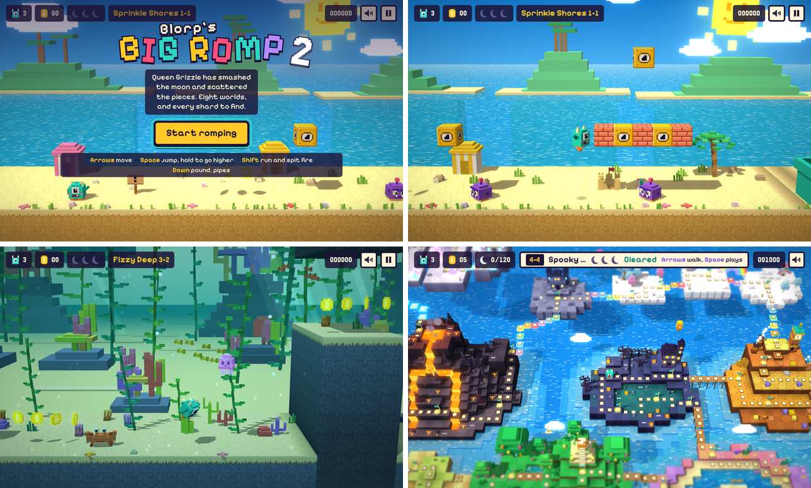

# Blorp's Big Romp 2

A voxel platformer with a 2.5D side-scrolling view, built with [three.js](https://threejs.org/), and the sequel to [Blorp's Big Romp](https://github.com/glennbacon/blorps-big-romp). Queen Grizzle has smashed the moon and scattered the pieces. Blorp, a one-eyed teal monster, crosses eight worlds and forty levels to get them back: three moon shards are hidden in every level, 120 in all.

**[Play it in your browser](https://glennbacon.github.io/arcade/blorps-big-romp-2/)**



It is one of the games in [Glenn Bacon's arcade](https://glennbacon.github.io/arcade/), next to the first game.

The whole game is one HTML file. There are no image or sound files: every model is built in code from boxes, every texture is drawn on a 16×16 canvas, and all music and sound effects are synthesized with the Web Audio API.

## Play

Play online at <https://glennbacon.github.io/arcade/blorps-big-romp-2/>.

To run it from a copy of this repository, open `index.html` in a current version of Chrome, Safari, Firefox or Edge. Nothing needs installing. An internet connection is needed either way because three.js and the fonts load from CDNs.

## Controls

In a level:

| Action | Keyboard | Touch |
| --- | --- | --- |
| Move | Arrow keys or A / D | Arrow pads |
| Jump (hold to go higher), swim, kick off a wall | Space, Up, W or Z | A |
| Run, and spit fire in fire form | Shift or X | B |
| Ground pound (in the air), go down a pipe, sink faster | Down or S | ▼ |
| Pause | P or Esc | Pause button |
| Sound on/off | M | Sound button |

On the map:

| Action | Keyboard | Touch |
| --- | --- | --- |
| Walk along the path | Arrow keys or W A S D | Four-way pad |
| Walk faster | Shift or X | B |
| Play the level Blorp stands on | Space, Enter, Z or K | A |
| Sound on/off | M | Sound button |

On a phone held upright the game sits above a handheld-style control deck. In landscape the controls float over the bottom corners, and in a level the view rides up so the ground Blorp walks on stays above them.

## What is new since the first game

**Moves**

- **Wall kick.** Push against a wall in mid-air and Blorp slides down it slowly. Jump, and he kicks off the other way. Two walls facing each other can be climbed.
- **Ground pound.** Press down in the air. Blorp slams straight down: it flips a switch from above, shakes monsters off their feet, knocks whatever a block holds out of it, and, once he is big, smashes bricks beneath him one after another.
- **Swimming.** In water each press of jump is a stroke upward. At the surface, jump leaps out. Holding down sinks faster. Monsters cannot be stomped under water.
- **Pipes.** A pipe with a band of arrows goes somewhere. Stand on it and press down.

**Power-ups**

- Muffin makes Blorp big, chili gives fire spit, star jelly makes him invincible for ten seconds, a heart is an extra life, and 100 coins are another: all as before.
- **Candyfloss** gives the fluff form. Jump again in mid-air for a second jump, and hold jump while falling to glide. Updrafts carry a gliding Blorp higher.

**Moon shards**

Every level hides three. One is usually in plain sight, one takes a trick, and one is tucked away. A shard is kept the moment it is touched, even if Blorp then loses a life. The map shows how many each level has given up.

**Things in the levels**

Crumbling blocks, conveyor belts, a switch that turns red blocks off and blue blocks on, launch pods, falling and circling ledges, updrafts, flame jets, cannon blocks, hint signs, and secret rooms at the far end of a pipe.

**Monsters**

The first game's Grumblobs, Shellbys, Spikits, Battys, Boings, Chompers, Prickles and icicles are back. New: Snippy the crab, who turns back at ledges; Wobbly the jellyfish and the Puffer, in the water; Snappers, which leap out of it; Emberlings, which do the same out of lava; Shyde the ghost, who only moves while Blorp's back is turned; Clonk, a stone slab that drops when Blorp walks under; rockets; Fizzle the walking bomb, who can be stomped, kicked and used to blow up bricks; Zappy the storm cloud; and Bonk, who charges on sight and smashes bricks with his head.

**Bosses**

Big Bongo in the jungle, Count Boohoo in the hollow, Lord Zappa above the clouds, and Queen Grizzle on what is left of the moon. Each takes stomps: three, three, four and five.

**Worlds**

1. **Sprinkle Shores**: a beach, and the place to learn the new moves.
2. **Jellybean Jungle**: launch pods, crumbling ruins and a long climb.
3. **Fizzy Deep**: under the sea.
4. **Spooky Hollow**: a haunted wood at night, where ghosts follow and blocks blink on and off.
5. **Tick-Tock Works**: a clockwork factory of belts, cannons and crushers.
6. **Cloud Nine**: above the clouds, with candyfloss to glide on and nothing below.
7. **Magma Mountain**: lava, flame jets and falling ledges.
8. **Lunar Palace**: low gravity, and the Queen.

**Looks and sound**

The picture is drawn with real-time shadows, baked corner shading, a bloom on everything that glows, water you can see into, a shader sky, plants that sway, and three small lights that follow whatever is burning nearby. The pause screen has a graphics setting; on *Auto* the game steps down by itself if a device cannot keep up. Music is a four-track sequencer with drums and echo, a different tune for every world, and it goes dull when Blorp's head is under water.

## Saved progress

The game remembers, in the browser's local storage, how far the path is open, which marker Blorp stands on, his score, coins, lives and power-up, every moon shard found, and the graphics setting if one was chosen by hand. The title screen then offers **Continue**. Game over resets the score, coins, lives and power-up but not the map or the shards. If the browser blocks storage, the game still plays but forgets where you were.

## Physics

Walking, running, skidding and jumping use the NES Super Mario Bros. speeds and gravities, converted from pixels per frame to tiles per second, with the first game's slightly stronger jump (about 4.2 tiles standing, 5 running) and its jump buffering and ledge forgiveness. The simulation runs at a fixed 120 steps per second, independent of frame rate.

## Project layout

| Path | What it holds |
| --- | --- |
| `index.html` | The built, playable game |
| `src/head.html` | Page markup, styles, HUD, screens and touch deck |
| `src/a_art.js` | Voxel geometry builder, materials, pixel textures and every model |
| `src/b_levels.js` | Tile types, the level builder, and the list of worlds |
| `src/c_audio.js` | Sound effects and the sequencer music |
| `src/d_render.js` | Renderer, lights, shadows, the sky, quality settings and post-processing |
| `src/e_world.js` | Terrain mesher, water, the scenery framework, effects and the level camera |
| `src/f_play.js` | Player physics, blocks, power-ups, pipes, ledges and everything else that moves by rule |
| `src/g_enemies.js` | Every monster and boss |
| `src/worlds/` | One file per world: its looks, its scenery and its five levels |
| `src/m_map.js` | The world map's islands, its route, and the rules of what is open and of walking |
| `src/n_mapview.js` | Drawing the world map |
| `src/z_flow.js` | Level loading, animation, screens, saving, input and the main loop |
| `src/tail.html` | Closing markup |
| `build.sh` | Joins the pieces in `src/` into `index.html` |
| `screenshot.png` | The picture at the top of this page |
| `tools/` | Checks that run in Node (see below) |

## Build

```bash
./build.sh
```

This needs only bash. If Node.js is installed, the script also checks the game script for syntax errors.

## Checks

```bash
node tools/check-levels.js              # every level and every shard; add --jobs 4 to use four processes
node tools/check-levels.js 4-2          # one level
node tools/check-levels.js --quick 4-2  # the way to the flag only, not the shards
node tools/check-levels.js --map 4-2    # print a level as text
node tools/check-map.js                 # the world map: its route, walking, opening levels, controls
node tools/check-map.js --map           # print the islands as text
node tools/check-save.js                # saved progress, moon shards and Continue
node tools/check-audio.js               # every sound effect and every tune
```

These need Node.js and nothing else. The level check loads the game code from `src/` with the 3D and page layers stubbed out, then has a search bot play each level with the real rules until it reaches the flag or beats the boss. Each level is played as small Blorp and as big Blorp, who must not get hurt, and the bot jumps 5% lower than a player can. The bot then goes after each of the three moon shards. It also reports common slips, such as a monster placed in mid-air, a pipe that leads nowhere, a roof low enough to hit when jumping for the flag, or a tree standing in front of the checkpoint flag. Run it after editing a level.

The map check proves there is one marker per level, that the path moves one cell at a time, never climbs more than one step, never crosses or runs alongside itself and is never hidden by the ground, and then drives the real walking rules, the flow between map and levels, and the map's keys and touch pad. The save check starts the game the way a page load does, with a stand-in for the browser's storage, and checks what is saved at each point and what the title screen offers afterwards. The audio check calls every effect and plays every tune twice through against a strict stand-in for Web Audio.

## Making levels

A level is a function that builds itself with a small builder and returns `B.L`. Coordinates are in tiles; the walking surface is at `y = 2` (ground fills rows 0 and 1), and a level is 16 tiles tall unless it asks for more.

```js
function w1l9(){
  const B=LevelBuilder(204,'shores');   // width in tiles, theme, and optionally height (default 16)
  B.ground(0,44).ground(48,203)         // ground from column 0 to 44, a gap, and on to the end
   .row(21,5,'B?BMB')                   // a row of blocks starting at column 21, height 5
   .pipe(31,2,true)                     // a pipe two tiles tall; true adds a Chomper
   .enemy('blob',27)                    // a monster standing on the ground at column 27
   .enemy('batty',40,6,{rx:3})          // one in the air at height 6, with options
   .plat(60,4,3,'x',5,1.3)              // a ledge 3 wide that slides 5 tiles along x
   .water(70,2,90,5)                    // a pool: both corners, in tiles
   .shard(80,3).shard(120,9).shard(150,4,'fluff')
   .checkpoint(100)
   .goal(190);                          // the flag; a boss level ends with .boss(...) instead
  return B.L;
}
```

Characters for `row`:

| Char | Tile | Char | Tile |
| --- | --- | --- | --- |
| `B` | Brick | `m` | Brick holding many coins |
| `?` | Coin block | `s` | Brick holding a star |
| `M` | Power-up block (muffin, then chili) | `I` | Hidden block with a life |
| `F` | Power-up block (muffin, then candyfloss) | `i` | Hidden block with a coin |
| `S` | Star block | `H` | Hard block |
| `L` | Life block | `=` | One-way ledge |
| `C` | Coin | `^` | Spikes |
| `#` | Ice | `K` | Crumbling block |
| `X` | Toggle switch | `<` `>` | Conveyor belt, left and right |
| `R` | Red block (solid until the switch is hit) | `U` | Blue block (solid after) |

Everything the builder can do:

| Call | What it makes |
| --- | --- |
| `fill(x0,y0,x1,y1,TILE)` / `clear(x0,y0,x1,y1)` | A box of one tile (`GROUND`, `HARD`, `BRICK`, `ICE`, ...) or of nothing |
| `ground(x0,x1,h)` | Ground from row 0 up, `h` rows tall (default 2) |
| `ice(x0,x1,y)` | A strip of ice; with no `y`, the top row of ordinary ground |
| `row(x,y,'...')` | A row of tiles from the table above |
| `coins(x,y,n)` `coinCol(x,y,n)` `coinBox(x0,y0,x1,y1)` `arc(x,y,n)` | Coins in a row, a column, a block, and an arch for a jump |
| `stairs(x,n,dir,base)` | `n` steps of hard block, rising to the right (`dir` 1) or the left (-1) |
| `pipe(x,h,chomper,base)` | A pipe two tiles wide |
| `warp(x,h,tag,oneWay,base)` | A pipe Blorp can go down. Two warps with the same tag are the two ends; `oneWay` makes this end an exit only |
| `room(x0,x1,y0,y1,bonus)` | A part of the level the camera stays inside. The first room is where the level starts. Put a secret room beyond the hut, walled in, and reach it by a warp |
| `enemy(type,x,y,opts)` | A monster. `y` defaults to the ground |
| `plat(x,y,w,axis,range,speed,phase)` | A moving ledge: axis `'x'` or `'y'` slides, `'c'` circles at radius `range` |
| `fall(x,y,w)` | A ledge that drops away a moment after Blorp lands on it |
| `spring(x,y)` | A springshroom |
| `pod(x,y,angle,power)` | A launch pod, aimed `angle` degrees from straight up, firing at `power` tiles a second (24 goes about ten tiles up) |
| `wind(x0,y0,x1,y1,ax,ay)` | Moving air, as a push in tiles per second squared. About 110 upward lifts anyone; 60 lifts only a glider |
| `jet(x,y,len,period,phase)` | A flame jet standing on the floor at row `y` |
| `cannon(x,y,period,phase)` | A block that fires rockets toward Blorp |
| `firebar(x,y,n,speed,phase)` | A spinning chain of embers around a hard block |
| `spikes(x0,x1,y)` | Spikes |
| `water(x0,y0,x1,y1)` | A box of water to swim in |
| `liquid(y)` | Where the stuff in the pits stands (default 1.3) |
| `conveyor(x0,x1,y,dir)` | A belt |
| `sign(x,text,y)` | A hint sign. `{jump}`, `{run}` and `{down}` become the right key or button names |
| `shard(x,y,needs)` | One of the three moon shards. `needs` is `'fluff'` or `'fire'` if it cannot be reached without |
| `checkpoint(x,y)` `start(x,y)` `goal(x,y)` | The halfway flag, where Blorp begins, and the flagpole (on the ground unless `y` says higher; it needs 18 tiles of floor after it) |
| `boss(x,x0,x1,hp,kind)` | A boss and the stretch it may walk; kinds are `bongo`, `boohoo`, `zappa`, `queen`. A stomp takes 3 hit points |
| `look(i)` | Use another of the theme's looks than the one that goes with the level's number |
| `set(key,value)` | Leave a note for the theme's scenery, read there as `S.L[key]` |

Monster types and their options:

| Type | Options | Notes |
| --- | --- | --- |
| `blob` `spikit` `shellby` `boing` `prickle` `fizzle` `rammy` `snippy` | | Walkers; stand them on something |
| `batty` | `rx` `ry` `sp` | Flies a figure of eight that wide and tall |
| `chomper` | | Use `pipe(x,h,true)` |
| `icicle` | | Needs a solid tile directly above |
| `jelly` | `ry` `rx` `sp` | Must be in water. Bobs `ry` up and down from where it is put |
| `puffer` | `rx` `sp` | Must be in water. Swims `rx` either way |
| `snapper` `ember` | `rise` `gap` `phase` | Leaps `rise` tiles above where it is put, every `gap` seconds. Put it over a pit, at `y` 2 |
| `ghost` | | Floats through walls |
| `clonk` | | Put it in the air; it drops to the floor below and climbs back |
| `zappy` | `rx` | Hovers at its height and follows Blorp up to `rx` tiles either way |

What Blorp can do, for judging a jump: about 4 tiles up from a standstill and 5 from a run; a gap of 4 tiles at a walk and 6 at a run, comfortably. A wall kick gains about 4 tiles a kick between walls 2 to 5 apart. A spring throws him about 8 tiles up. The fluff form's second jump adds about 3.5. In Lunar Palace gravity is 0.7 and everything goes further.

For poking at a running game, the browser console has a `__romp` object: `__romp.load(7)` jumps to a level (levels count from 0, so 7 is level 2-3), `__romp.tp(x, y)` moves Blorp, `__romp.form(3)` changes his form, and `__romp.quality(0..2)` sets the graphics. Adding `?q=2` to the address forces full graphics.

## Making a world

Each file in `src/worlds/` holds one world: a theme, the functions that build its five levels, and one call that lists them.

```js
THEMES.shores={ music:'shores',
  sky:['#1f8fe8','#7fd4ff','#fff3cf'],   // top, middle and horizon colours of the sky; skyMid is where the middle sits
  fog:0xbfeaff, fogNear:16, fogFar:150,  // haze, and how far behind the lane it starts and ends
  hemiSky:0xffffff, hemiGround:0xd9c9a0, hemiI:0.62, sunI:0.66, sunCol:0xfff3d6, sunDir:[-0.45,0.76,0.5],
  top:..., topS:[...], dirt:..., dirtS:[...], cap:..., capL:..., capD:...,   // ground: its top, its earth and the lip between
  brick:[...], hard:[...], pipe:[...], semi:'plank', plat:[...],             // blocks, pipes, one-way ledges, moving ledges
  back:-6,                               // how far back the ground runs before the far scenery (default -2.5)
  fringe:[...],                          // colours of grass along the ground's front lip, if any
  liquid:{kind:'water',a:...,b:...,op:0.8,far:120},   // what stands in the pits. 'water' can be swum in, 'void' is nothing at all, anything else is deadly
  looks:[null,{...},{...},{...},{...}],  // what to change for levels 2 to 5: usually sky, fog and light
  scenery(S,R){ ... },                   // the far view
  decor(S,D,R){ ... }                    // what stands on each tile of open ground
};
defWorld({name:'Sprinkle Shores',theme:'shores',levels:[w1l1,w1l2,w1l3,w1l4,w1l5]});
```

`scenery(S,R)` and `decor(S,D,R)` add boxes to lists, each box `[x,y,z,w,h,d,colour]` from its lowest corner. `R()` is a random number that is the same every time the level loads.

| List | Units | Drawn |
| --- | --- | --- |
| `S.far` | tiles | Lit, no shadows: hills, walls, anything distant |
| `S.glowFar` | tiles | Unlit and blooming: windows, lava falls, crystals |
| `S.soft` | tiles | Unlit, a faint bloom: clouds, mist |
| `S.near` | eighths of a tile | Lit, with shadows: props beside the lane |
| `S.flora` | eighths of a tile | The same, and it sways in the wind |
| `S.glow` | eighths of a tile | Unlit and blooming |

`put(list,model,x,y,z,gain)` adds a whole model (a list of boxes) to a list at a place; `gain` sets how much it sways. Helpers: `hill`, `pyramid`, `S.addCloud(x,y,z,R,tint,speed)`, `S.addMotes(colour,count,size,fall,glow)` for dust, snow, embers or bubbles, and `skyDisc(colours,ring,y)` for a sun, moon or planet. Things that move by themselves go in `critters` as `{tick(dt,time){...}}`, and lamps that should light their surroundings in `lamps` as `{x,y,z,col,power,reach}`. `decor` is called once for every tile of open ground with `D`: `D.ty` is the height of the surface, `D.free(n)` says whether `n` tiles above it are clear, `D.open` is false near the checkpoint, the hut and signs (keep tall props away), `D.wet` is true under water, and `D.jx()`, `D.zb(a,b)` and `D.zf()` give a spot along the tile, on the shelf behind the lane between two depths, and on the lip in front.

The lane Blorp walks in is at depth 0, blocks reach one tile either side of it, the camera looks from the front (positive z), and anything in the way of the lane must be kept out of it: nothing taller than a flower nearer than 1.2 tiles behind, and nothing at all in front but small things on the lip.

A world's file may also add monsters of its own with `defEnemy` (see `src/g_enemies.js`) and models of its own.

## Editing the map

The islands are painted in `buildIsle` in `src/m_map.js` with a small builder, on a grid 64 cells wide and 44 deep with north at the top. Heights are in steps of half a tile, and each piece of land belongs to a world (0 to 7).

```js
B.blob(10,36,8.4,5.6,0,2)        // an ellipse of land: middle, radii, world, height
 .raise(5.5,33.6,3,2,0.7)        // a hill on land that is already there: middle, radius, extra height, roundness
 .flat(9,39.5,6,1.6,1)           // level an area
 .plate(29,30,31,32,6)           // set a rectangle of land to one height
 .pool(24.6,33.2,1.4,1,MK_POND)  // turn land into water, lava or goo
 .cut(8.5,4,0.6,3.6)             // take land away
 .lift(41,8,24,6.4,12)           // make land float, its underside at this height
 .tidy()                         // smooth the coast
 .route(4,38,['EEENN','NNN'])    // where the path starts, then compass moves from each marker to the next
```

The route's heights are worked out from the land it crosses: it cuts and fills by halves so that no step is more than one high, and it bridges sea, lava and thin air by itself. The scenery, the landmarks and everything that moves on the map are in `src/n_mapview.js`. Run `node tools/check-map.js` after any change.

On the map, `__romp.open(40)` opens every level, `__romp.at(12)` stands Blorp on a marker, and `__romp.zoom(2.6)` pulls the camera back far enough to see everything.

## Credits

- [three.js](https://github.com/mrdoob/three.js) r128, MIT license, loaded from cdnjs.
- [Pixelify Sans](https://fonts.google.com/specimen/Pixelify+Sans), SIL Open Font License, loaded from Google Fonts.
- [Jersey 20](https://fonts.google.com/specimen/Jersey+20), SIL Open Font License, loaded from Google Fonts. It is used for the digits only.

The characters, levels, art and music are original to this project and its predecessor.

## License

[MIT](LICENSE)
